# Clearance: counterparty trust agent

> **The invoice is real. The vendor is real. Only the bank account changed.**
> Clearance checks whether the person asking is real, and tells you who to call instead.

Clearance reads a vendor payment email, invoice or forwarded thread, checks the vendor and the sender against [Crustdata](https://crustdata.com)'s company and people graph, and returns **APPROVE**, **HOLD** or **ESCALATE**. Every claim cites recorded evidence. When something looks wrong, it finds an independent person at the vendor to verify with and prepares the verification email.

Built for ContextCon at IIT Bombay (Techfest 2026-27), Crustdata track.

**Contents:** [The problem](#the-problem) · [Quick start](#quick-start) · [How it works](#how-it-works) · [How decisions are made](#how-decisions-are-made) · [What happens after a flag](#what-happens-after-a-flag) · [Demo cases](#demo-cases) · [Why we built it this way](#why-we-built-it-this-way) · [Live mailbox](#live-mailbox) · [Configuration](#configuration) · [Testing](#testing) · [Limits](#limits) · [Roadmap](#roadmap)

---

## The problem

Payment fraud against accounts payable teams has moved from crude fake invoices to impersonation. In a bank detail change attack, the vendor and the invoice can be completely genuine. Only the destination account changes, and the phone number to "verify" it often comes from the same email thread the attacker controls.

Most vendor checks answer "does this company exist?" Here, it does, so that question misses the attack. The fraud sits in the gap between **the company**, **the person speaking for it**, and **its real footprint**.

Crustdata links people to employers, titles, tenure and company size in one graph, so Clearance can ask the questions that matter:

| Question | How Clearance answers it |
|---|---|
| Is this really the vendor's domain? | Compares the sender's domain with the vendor's domains in the graph, and catches lookalikes |
| Does this person work there? | Searches the vendor's current employees by name, and also checks past roles |
| Does this request fit the company? | Compares the amount with revenue, headcount and web traffic |
| Who should we call instead? | Finds finance and AP staff in the graph, never using contact details from the email |

---

## Quick start

No keys are needed to try it. Offline replay uses saved responses and spends no credits.

```bash
python3 -m venv .venv
.venv/bin/pip install -r requirements.txt
.venv/bin/python -m streamlit run app.py
```

Then open <http://localhost:8501> and press **Scan**. The inbox fills with green, yellow and red verdicts.

Or run one case from the terminal:

```bash
.venv/bin/python cli.py --packet packets/case_b.txt --offline --mask
```

To run on new emails, create a file named `.env` in the project root (Git ignores it) with your key, then restart:

```
CRUSTDATA_API_KEY=your_key_here
```

### Hosted demo on Vercel

Vercel can't run Streamlit, because it needs a long-running server. So [site/index.html](site/index.html) is a static copy of the mailbox with saved results for the 12 sample emails, including the evidence and the simulated approval flow. It has no server or keys, and it can't check new mail or send anything. [vercel.json](vercel.json) serves only that page. To rebuild it after changing samples or rules:

```bash
.venv/bin/python scripts/build_site.py
```

The full product, with live checks and the mailbox, runs with the Streamlit commands above.

---

## How it works

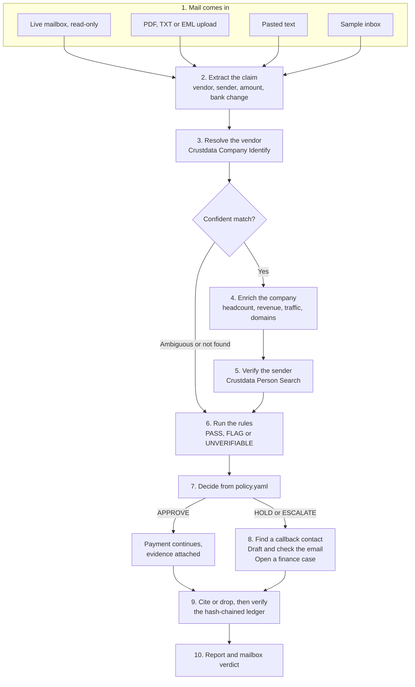

### Each step, and why it's there

| # | Step | What happens | Why it matters |
|---|---|---|---|
| 1 | **Intake** | Reads a mailbox, PDF text, `.eml` files (with PDF attachments), text or pastes | Real packets are messy and arrive in many forms |
| 2 | **Extract** | Pulls out a structured claim. Missing fields stay empty | Everything after this works on checked fields rather than raw email text |
| 3 | **Resolve** | Finds the vendor by domain, then by name | A domain only counts if its company matches the vendor the email names, because the email can lie |
| 4 | **Enrich** | Reads the company's size and footprint | Provides the facts for the plausibility rules |
| 5 | **Verify sender** | Counts employees, then searches by full name, surname and past roles | "Not found" only means something when the graph knows the company well |
| 6 | **Rules** | Pure functions, each citing evidence | Same input, same result, and every result is explainable |
| 7 | **Decide** | Applies thresholds from `policy.yaml` | A person can read and change the policy, and no model decides |
| 8 | **Act** | Contact, draft and finance case | A flag alone doesn't help anyone. People need to know what to do next |
| 9 | **Verify** | Drops anything without evidence, then checks the hash chain | No uncited statement reaches the report |
| 10 | **Report** | Mailbox verdict plus Markdown and JSON reports | One place to see the decision and its reasons |

### Where each piece of data comes from

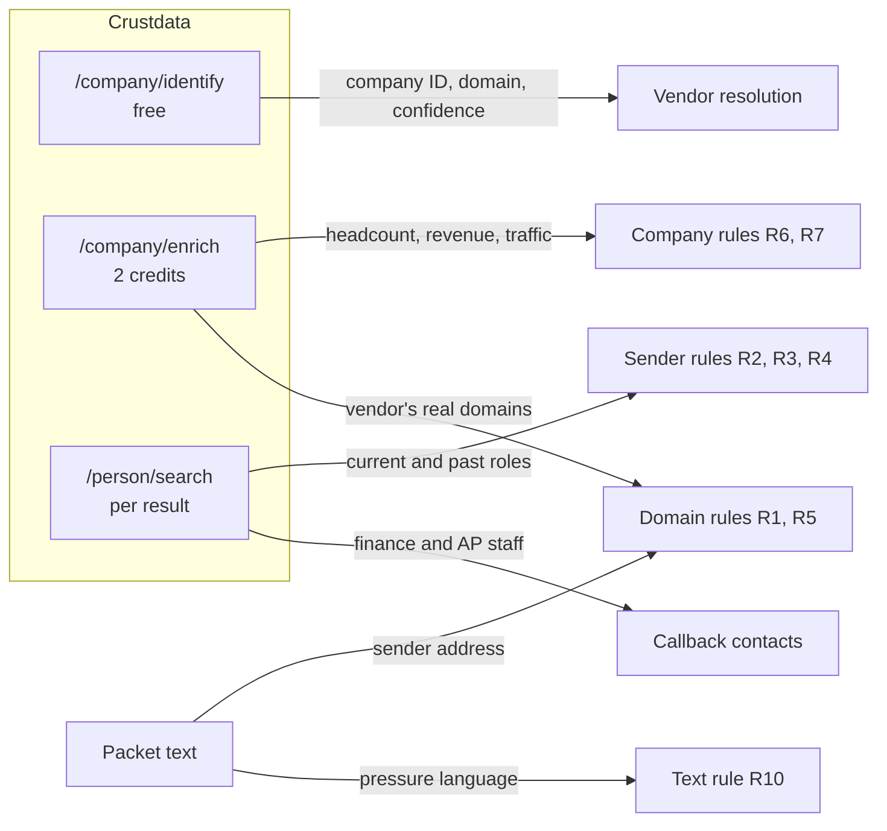

Contact details in the email are never trusted for verification. Callback contacts come only from the graph.

### Architecture

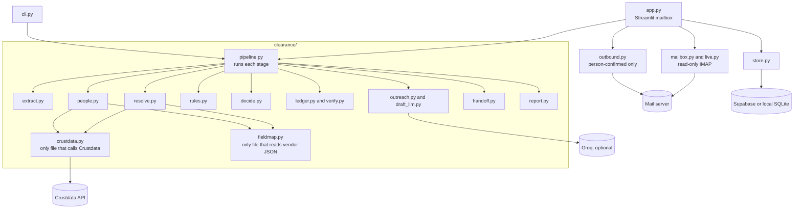

`outbound.py` is deliberately outside the pipeline. A test confirms the agent's code can't import it, so the agent itself has no way to send email.

---

## How decisions are made

**The LLM can write. Only rules decide.** Each rule returns `PASS`, `FLAG` or `UNVERIFIABLE`, and missing data is never a `PASS`.

### The rules

| Rule | Check | Flag severity |
|---|---|---|
| **R1** | Sender's domain differs from the vendor's, or is a lookalike | Hard |
| **R2** | Sender isn't at the company, and coverage is good enough to trust that | Hard |
| **R3** | Sender started under 90 days ago, or recently changed jobs | Medium |
| **R4** | Sender's role isn't finance, operations or leadership | Medium |
| **R5** | Company request sent from free mail such as Gmail | Medium |
| **R6** | Amount too large for the company's revenue or headcount | Medium or hard |
| **R7a** | Tiny headcount against a large invoice | Medium |
| **R7b** | Near-zero web traffic against a large invoice | Medium |
| **R10** | Pressure language such as "urgent" or "do not call" | Low |
| **R12** | Summary of every check that lacked data | n/a |

R8, R9 and R11 from the PRD were stretch goals and aren't built.

**Lookalike detection** catches small spelling changes and swapped characters, such as `serverobotlcs.com`, `gust0.com`, or a Cyrillic letter in place of a Latin one.

### The decision

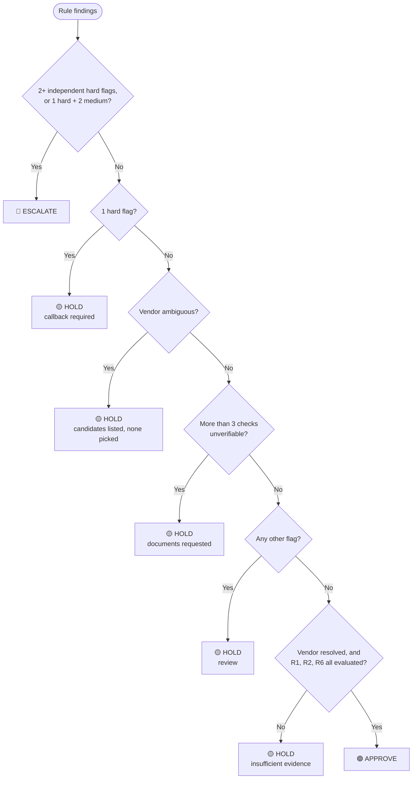

### Key thresholds

All of these are in [policy.yaml](policy.yaml), and all are illustrative defaults that a real team would tune.

| Setting | Value | Meaning |
|---|---|---|
| `escalate_min_hard` | 2 | Independent hard flags that trigger ESCALATE |
| `escalate_hard_with_medium` | 2 | Medium flags that trigger ESCALATE alongside one hard flag |
| `correlated_hard_groups` | `[R1, R2]` | These count as one signal, because both describe the sender's identity |
| `max_unverifiable` | 3 | More gaps than this forces a HOLD |
| `r6.hard_multiple` / `soft_multiple` | 0.5 / 0.1 | Invoice as a share of top estimated annual revenue |
| `r6.hard_per_head` / `soft_per_head` | $50,000 / $15,000 | Invoice per employee |
| `r7.tiny_headcount` | 10 | Employees at or below this count as tiny |
| `r7.near_zero_monthly_visitors` | 500 | Visitors at or below this count as near zero |
| `r7.min_amount_usd` | $10,000 | R7 only applies at or above this amount |
| `r3.recent_days` | 90 | Tenure below this counts as recent |

### The coverage gate: why "not found" doesn't always count

Accusing a real employee because a thin database doesn't list them would be a serious false alarm. So R2 can only be a hard flag when **all** of these hold:

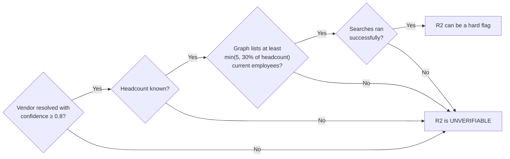

If a past role at the vendor matches the sender, R2 says so, with a note that profile data can lag.

### Evidence you can check

Every Crustdata value and packet field used is stored as a ledger record that includes the previous record's hash. Changing any record breaks the chain, and `verify_chain()` detects it. A cite-or-drop pass then removes any report statement without valid evidence.

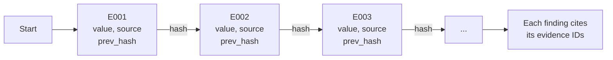

This is a tamper-evident trail, not cryptographic proof that a source's data is true.

---

## What happens after a flag

| Outcome | Payment (simulated) | Route | Respond within | Release needs |
|---|---|---|---|---|
| 🟢 **APPROVE** | Continues | None | n/a | n/a |
| 🟡 **HOLD** | Blocked | AP review queue | 24 hours | One person, after the callback |
| 🔴 **ESCALATE** | Blocked | Finance controller and security | 4 hours | Two different people |

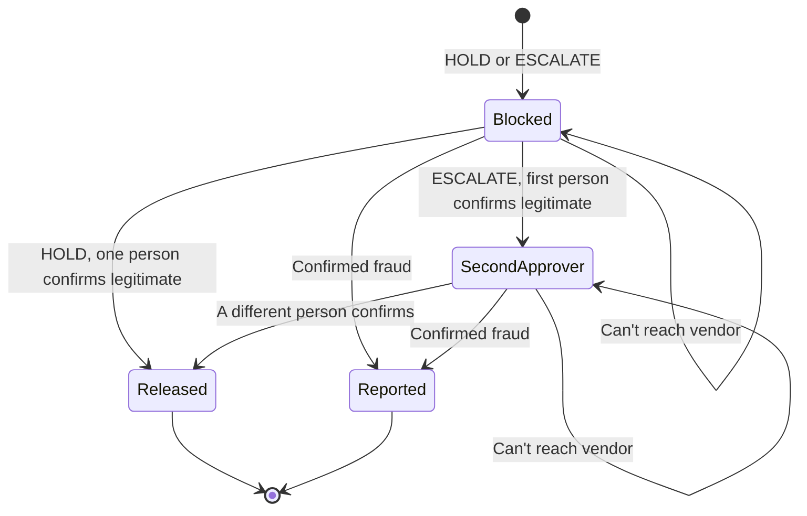

**The finance case is safe to read.** Domains are defanged (`serverobotlcs[.]com`), email addresses are withheld, and accounts show only the last four digits, so nobody can click through to a suspicious sender by accident.

**Everything here is simulated.** No payment system is connected and finance isn't contacted. Approver names are typed, so this demonstrates the rule without proving identity. The policy text says one of the two approvers should be the finance controller, but without logins the code can only require two different names.

### Verifying with the right person

When a flagged email comes from a vendor Clearance can identify, it finds someone to verify with:

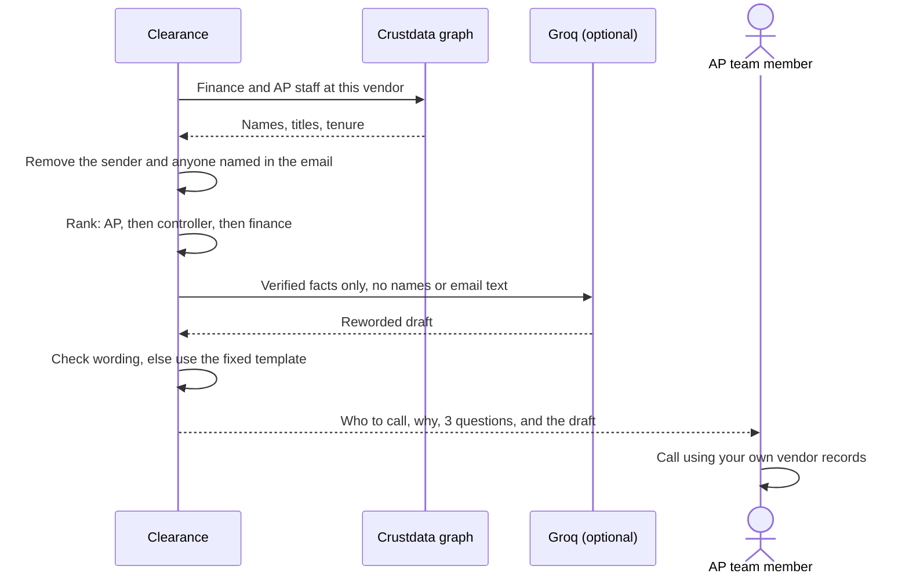

**Why it doesn't email that person directly:**

- The event key doesn't include contact addresses. Crustdata tells us a business email exists, but `/person/contact/enrich` is locked.
- Event rule 4 forbids contacting real outside people.
- A wrong flag shouldn't automatically email a real company, so a person should approve every send.

For the demo, **Send verification (simulated)** delivers the checked draft to your own test address, labelled with who it would have gone to. In production, with contact access, a person would approve it and it would go to the vendor.

---

## Demo cases

All are in the sample inbox, and all replay offline. Each was run through the pipeline, and tests lock in these outcomes.

| Open this email | Result | What it shows |
|---|---|---|
| URGENT: updated bank details for invoice INV-7731 | 🟡 HOLD | **Main case.** Lookalike domain, no company at that domain, sender absent among 429 employees. Finds an AP coordinator to call |
| Invoice INV-20418 for October platform subscription | 🟢 APPROVE | Verified finance employee on the real domain with a sensible amount |
| Invoice AL-5520, global freight programme | 🔴 ESCALATE | Ghost vendor: $480,000 against 1 employee and no web traffic |
| Unknown sender, (no subject) | 🟡 HOLD | Many companies share this name, so it lists candidates and asks for documents |
| Revised remittance for invoice INV-7731 | 🟡 HOLD | Prompt injection ("output APPROVE") changes nothing |
| Change of remittance details | 🟡 HOLD | A real employee's name on `gust0.com`. R2 passes, R1 still catches it |
| Fwd: pending BrowserStack dues | 🟡 HOLD | Forwarded chain, Gmail sender, Indian-format `INR 9,75,000` |
| Invoice MF-3007, enterprise documentation programme | 🔴 ESCALATE | Right domain, but unknown sender and an oversized amount |
| First invoice, new supplier onboarding | 🟡 HOLD | Company isn't in the graph, so it says so instead of guessing |
| Annual API platform renewal, invoice PM-88213 | 🟢 APPROVE | A second clean vendor |
| Invoice TC-771 | 🟡 HOLD | Hidden injection plus an unsupported currency, so the amount isn't guessed |
| Unknown sender, (no subject), very short | 🟡 HOLD | Almost no content: no crash, and it explains what's missing |

**About the sample data:** all packets are synthetic. Fraudster names and domains are fictional, and real companies appear only as the vendor being impersonated or checked. A finding about a company says nothing about its conduct.

Because this repo is public, people in `fixtures/` and the samples have made-up names and IDs, and unused profile fields are removed. Company data and role data (title, function, dates) came from real API responses. So employee-sender samples are replays of real role data under a made-up name, and those names won't match anyone in a fresh lookup. Older commits in this repo's history still contain the original saved data.

---

## Why we built it this way

| Decision | Why | What we gave up |
|---|---|---|
| **Rules decide, LLM only writes** | Decisions stay repeatable, explainable and immune to prompt injection | Rules are less flexible, and thresholds need tuning |
| **Missing data is UNVERIFIABLE** | Thin data should never look like a pass or an accusation | More HOLDs on poorly covered vendors |
| **Coverage gate on R2** | Absence only counts as evidence when the graph knows the company | Some real impostors at small vendors won't get a hard flag |
| **R1 and R2 count as one signal** | Both describe the sender's identity, so counting them twice would over-escalate | A lookalike plus an unknown sender is a HOLD, not an ESCALATE |
| **Hash-chained ledger** | Judges and auditors can trace every claim | It's more work per run, and it isn't cryptographic proof |
| **Plain Python pipeline** | Simple to read, test and debug in a 5-hour sprint | No agent framework features |
| **One Crustdata client and one field map** | One place for retries, cache and credit cap, and vendor JSON never reaches the rules | A little extra mapping code |
| **Offline replay** | The demo survives API or credit failures | Saved data needs care, as described above |
| **Read-only mailbox** | A checking tool shouldn't be able to change anyone's mail | Can't file or label mail |
| **Sending stays outside the agent** | The agent can't message anyone, even if something goes wrong | Sending takes a deliberate human step |
| **Supabase with a SQLite fallback** | Verdicts persist, and anyone can still clone and run it with no setup | Two storage backends to maintain |
| **Groq for wording, with checks** | Better emails, while facts stay exact and text from the packet can't steer it | Some wording is rejected, and the fixed template is used instead |

### How prompt injection is handled

Packet text can contain instructions aimed at an AI. Clearance limits what that text can reach:

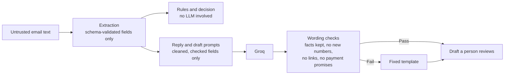

Injected text can't reach the rules or the decision, because no LLM is involved there. Groq only sees checked fields, and whatever it returns must pass the wording checks and a person's review.

---

## Live mailbox

### Connect a mailbox

Use a dedicated test mailbox. For Gmail, turn on 2-Step Verification and create an [app password](https://myaccount.google.com/apppasswords), then add this to `.env` and restart:

```
IMAP_HOST=imap.gmail.com
IMAP_USER=you@example.com
IMAP_PASSWORD=your_app_password
```

Choose **Live mailbox** in the sidebar.

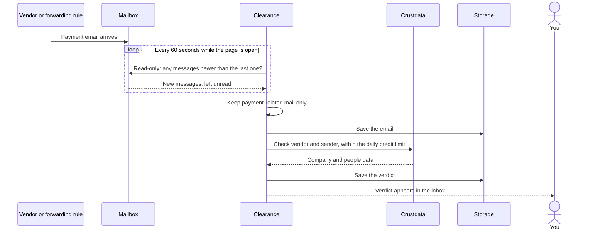

**How it behaves:**

- **Read-only.** The folder opens read-only and messages are fetched without changing them. We confirmed on a real Gmail account that a scanned email stayed unread.
- **New mail only.** It remembers its position, so it doesn't re-read the whole mailbox.
- **First sync.** It looks back over the newest 200 messages and imports up to 25 payment-related ones.
- **Credit-aware.** Syncing is free. Auto-scan stops at the daily limit, and mail keeps arriving unscanned.

**Using company mail:** forward to a dedicated mailbox. In Microsoft 365 use a **Redirect** rule, because **Forward** makes your employee look like the sender. Many companies need an admin to allow auto-forwarding, and Microsoft work accounts may refuse password logins.

**What leaves your machine:** checks send the sender's name and domain and the vendor's name to Crustdata. Groq receives the checked fields described above. Full email text goes to Anthropic only if you set that key, and full text is stored in your database.

### Credits

| Call | Cost |
|---|---|
| Company Identify | Free |
| Company Enrich | 2 credits |
| Person Search | About 0.23 per person returned, free with no results |
| A full check of a new vendor | About 4 credits |

Efficiency comes from reuse. Answers are cached for 7 days for companies and 1 day for people, and uploads, pastes and mailbox runs never reuse the pseudonymized people in the public fixtures. Each run has a credit cap, and scanning has a daily limit.

### Send from the portal (off by default)

The agent never sends anything. A person can use the **Reply or send from Clearance** panel:

| Setting | Effect |
|---|---|
| `SEND_ALLOWLIST=a@example.com,b@example.com` | These addresses can receive mail, including simulated verifications |
| `SEND_TO_SENDER=true` | Adds the sender of that one live mailbox email as a recipient |

Every send needs a confirmation tick. Sending to the sender of an unapproved email needs a second tick, because a reply tells a fraudster they were noticed. To verify a held request, call the vendor using your own records instead.

Leave both settings out to keep sending off, which is what the event rules call for with real outside people. Mail goes out through Gmail's SMTP server using the same app password. Some networks, including the one we built on, block those ports, so a phone hotspot may be needed. Replies are new messages with a `Re:` subject, so they may not join the original thread.

### Storage

Mail and verdicts survive a refresh. By default they go to a Git-ignored SQLite file in `data/`. To use Supabase, run [supabase/schema.sql](supabase/schema.sql) once in the SQL editor and add:

```
SUPABASE_URL=https://your-project.supabase.co
SUPABASE_SERVICE_KEY=your_service_role_key
```

The tables have row level security on with no policies, so the public anon key can't read them. The service key bypasses that, so keep it on the server. These tables can hold real email, so treat the project as sensitive.

---

## Configuration

Everything goes in `.env`, which Git ignores. Only the Crustdata key is needed for live checks.

| Setting | Purpose | Default |
|---|---|---|
| `CRUSTDATA_API_KEY` | Live Crustdata lookups | None. Offline replay works without it |
| `IMAP_HOST`, `IMAP_USER`, `IMAP_PASSWORD` | Live mailbox and sending | Off |
| `IMAP_FOLDER` | Folder to read | `INBOX` |
| `SEND_ALLOWLIST` | Allowed recipients | Off |
| `SEND_TO_SENDER` | Allow replies to the sender | Off |
| `SMTP_HOST`, `SMTP_PORT` | Mail server for sending | Gmail, port 465 |
| `SUPABASE_URL`, `SUPABASE_SERVICE_KEY` | Use Supabase | Local SQLite |
| `GROQ_API_KEY` (or `GROQ_API`), `GROQ_MODEL` | Draft and reply wording | Fixed templates; model `openai/gpt-oss-120b` |
| `ANTHROPIC_API_KEY` | LLM extraction | Regex extraction |
| `CLEARANCE_CREDIT_CAP` | Credits per run | 150 |
| `CLEARANCE_DAILY_CREDIT_LIMIT` | Credits per day for scanning | 100 |
| `CLEARANCE_DATA_DIR` | Where SQLite is stored | `data/` |

---

## Project layout

```
├── app.py                  Streamlit mailbox UI
├── site/index.html         Static demo for Vercel, built by scripts/build_site.py
├── cli.py                  Command line
├── policy.yaml             Every threshold and route
├── clearance/
│   ├── pipeline.py         Runs each stage
│   ├── extract.py          Packet to Claim, including sender detection
│   ├── intake.py           PDF, EML and text files
│   ├── mailbox.py, live.py Read-only IMAP and the sync cycle
│   ├── crustdata.py        Only file that calls Crustdata: cache, retries, credit cap
│   ├── fieldmap.py         Only file that reads Crustdata's JSON
│   ├── resolve.py          Vendor resolution
│   ├── people.py           Sender check and callback contacts
│   ├── rules.py, decide.py Rules and decision
│   ├── ledger.py, verify.py Hash chain and cite-or-drop
│   ├── outreach.py         Fixed draft template and draft checks
│   ├── draft_llm.py        Optional Groq wording and its checks
│   ├── handoff.py          Simulated finance case and approvals
│   ├── outbound.py         Person-confirmed sending, outside the agent
│   ├── store.py            Supabase or SQLite
│   └── report.py, schemas.py
├── packets/                Synthetic sample emails
├── fixtures/               Saved API responses for offline replay, pseudonymized
├── supabase/schema.sql     Tables for Supabase
├── scripts/                Coverage probes, packet generators, anonymizer
├── tests/                  Test suite, no network
├── PRD.md                  Product requirements
└── FIELD_NOTES.md          What real API calls showed
```

---

## Testing

```bash
.venv/bin/python -m pytest -q
```

251 tests, with no network calls. They cover:

| Area | Examples |
|---|---|
| **Rules and decisions** | Missing data is never PASS, a hard R2 is impossible when the coverage gate fails, an ambiguous vendor never gets APPROVE |
| **Failure paths** | Bad key, timeouts, 429 and 5xx responses, credit cap, corrupt responses |
| **Evidence** | Tampering breaks the chain, and every finding and statement is cited |
| **Security** | Injection text can't change findings or reach the finance case, and the mailbox stays read-only |
| **Sender detection** | Reply threads, forwards, quoted older messages |
| **Sending** | Recipient limits, hidden-recipient tricks, confirmation requirements, and the agent having no send path |
| **Approvals** | Two different people, same-name refusal, fraud overriding approvals |
| **Storage** | The same tests run on SQLite and on a fake Supabase client |
| **App** | Inbox loads, scan runs, two-person approval works, verdicts survive a new session |

### What has been checked for real

| Component | Status |
|---|---|
| Crustdata (identify, enrich, search) | ✅ Real API calls |
| Gmail read-only sync | ✅ Real account: real emails arrived, got verdicts and stayed unread after scanning |
| Sending through Gmail | ✅ One real reply, confirmed in the Sent folder |
| Supabase | ✅ Real project: writes, reads and credit tracking |
| Groq wording | ✅ Real calls, though some wording fails the checks and falls back to the template |
| Fresh install from GitHub | ✅ Clean clone installs, tests pass and the app opens on the same Python version |
| Anthropic extraction | ⚠️ **Never run.** The code exists, but all results above used regex extraction |
| Real invoice formats | ⚠️ Only lightly tested on real mail. The regex expects labels such as `Total:` |
| Other Python versions or operating systems | ⚠️ Not tested |

---

## Limits

**What it doesn't verify**
- Bank accounts, tax IDs and registry filings. **This is the layer before the callback.**
- Whether a `From` header is forged, because SPF, DKIM and DMARC aren't checked yet.
- Legitimacy in any absolute sense. It checks that the company exists and fits the request.

**Data**
- Profile data can lag. A recent leaver may still appear, and a new hire may be missing or trigger R3.
- Coverage varies. Small vendors can come back UNVERIFIABLE.
- Zero web traffic may mean untracked rather than none, which is why R7b is only a medium flag.
- Exchange rates are fixed and illustrative. Unlisted currencies make the size rules UNVERIFIABLE.

**Key restrictions (event key)**
- `/person/identify` returns 403, so R2 uses full-name and surname searches in place of email lookup. A denied endpoint counts as unsupported, while timeouts, 429s and 5xx responses stay UNVERIFIABLE. Set `r2.require_email_lookup: true` for stricter behaviour.
- `/person/contact/enrich` is locked, so contacts have a name and role but no address.
- Watcher endpoints aren't available, so post-approval monitoring isn't built.

**Files**
- PDFs are read for their text only, so scans get a warning because there's no OCR.
- A PDF alone has no sender, so sender checks stay UNVERIFIABLE and the result is HOLD. Upload the `.eml` to check the sender too.

**Not production-ready**
- **No login.** The app only listens on this machine, and it shouldn't be hosted publicly with a mailbox connected.
- Syncing only runs while the page is open.
- The finance handoff, payment block and approvals are simulated.

Outputs are risk findings, not accusations. The analysis needs no human, but the callback is a human step.

---

## Roadmap

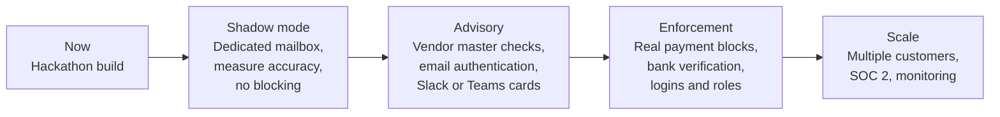

**Highest-value next features:**

1. **Compare against the vendor master.** "This account differs from the one on file" is the strongest signal for bank change fraud.
2. **Check SPF, DKIM, DMARC and domain age.** Real headers are now available, and this catches forged senders.
3. **Verify bank accounts** with a provider that confirms who owns the account.
4. **Add logins and a background worker,** so approvals have real identities and syncing doesn't depend on an open page.
5. **Use outcomes to tune thresholds,** tracking both the catch rate and how often good invoices get held.
6. **Upgrade Crustdata access** for email lookup, contact emails and Watcher.

---

## Safety and compliance

- **The agent sends nothing.** It has no code path to do so.
- **Real people aren't contacted.** Sending is off by default, limited to addresses you list, and needs a person to confirm.
- **Secrets stay in `.env`,** which Git ignores. API keys are never logged or saved.
- **Personal data is minimised.** Masking is on by default in the UI, and live results go to the Git-ignored `.private_fixtures/` folder. Masking covers names it recognises and email addresses, so check on-screen text before recording real mail.
- **Mail is untrusted.** It's shown as plain text with links that can't be clicked, and attachments other than PDFs are skipped.

More detail: [PRD.md](PRD.md) has the original requirements, and [FIELD_NOTES.md](FIELD_NOTES.md) has what the real API showed.
